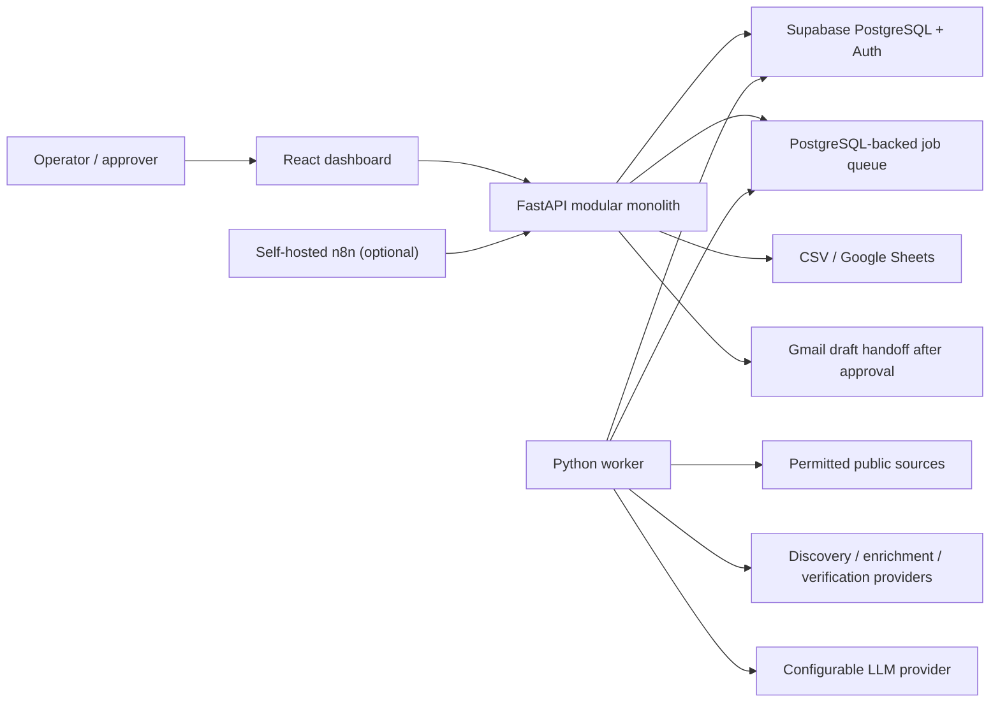

# Proposed architecture

**Status:** Proposed for review  
**Architecture style:** Modular monolith with asynchronous workers

## 1. Decision summary

Start with one backend codebase and one PostgreSQL database. Deploy the API and worker as separate processes from the same versioned application, not as independent services. Keep modules isolated through application interfaces so a high-volume capability can be extracted later if evidence justifies it.

React communicates only with FastAPI for business operations. Supabase provides hosted PostgreSQL and authentication; direct browser access to exposed tables should be avoided initially. n8n may schedule or invoke coarse-grained application commands, but orchestration state, budgets, retries, and business rules remain in Scout.

## 2. System context



The first vertical slice has no live provider, LLM, n8n, Sheets, or Gmail dependency.

## 3. Module boundaries

| Module | Owns | Does not own |
|---|---|---|
| `identity` | companies, people, roles, domains, match keys, merge decisions | discovery strategy |
| `discovery_individuals` | individual search definitions, candidates, promotion rules | company-first search |
| `discovery_businesses` | organization search definitions, candidates, decision-maker requests | individual-first search |
| `evidence` | source documents, claims, timestamps, verification, conflicts | qualification weights |
| `enrichment` | waterfall plans, eligibility, field freshness, adapter orchestration | provider-specific SDK behavior |
| `qualification` | ICP versions, rules, score runs, dispositions | source retrieval |
| `opportunities` | technical-need taxonomy, hypotheses, reviews | treating hypotheses as facts |
| `contacts` | professional contact points, verification state, purpose | outbound sending |
| `jobs` | scheduling, leases, attempts, retries, idempotency | domain decisions |
| `usage` | provider quotas, reservations, usage events, cost estimates | billing the customer |
| `outreach` | drafts, approvals, suppression checks, handoff state | autonomous campaigns |
| `reporting` | filtered exports and Google Sheets projections | canonical record ownership |
| `access` | workspaces, memberships, roles, audit events | Supabase identity lifecycle |

Modules may call another module through application services/ports. They must not update another module's tables directly from route handlers or adapters.

## 4. Two-stage processing

### Stage A: thin discovery

1. Validate a versioned search request and reserve its inexpensive budget.
2. Query a permitted source adapter or accept an import.
3. Store the raw candidate reference and provenance.
4. Normalize stable match fields.
5. Resolve exact duplicates; queue uncertain matches for review.
6. Apply cheap exclusion and ICP rules.
7. Promote only eligible candidates to a lead/deep-enrichment plan.

### Stage B: deep enrichment

1. Load the lead, ICP version, existing evidence, and field freshness.
2. Build the next eligible enrichment step.
3. Check suppression, provider availability, license/caching policy, and budget.
4. Reserve estimated units atomically before the external call.
5. Invoke the adapter with an idempotency/correlation identifier where supported.
6. Store usage, source document metadata, and atomic claims.
7. Reconcile conflicts without silently overwriting higher-quality evidence.
8. Re-score and stop when goals, rejection rules, or budgets are reached.

## 5. Ports and adapters

Core code depends on small typed protocols, for example:

```python
class DiscoveryProvider(Protocol):
    async def discover(self, request: DiscoveryRequest) -> DiscoveryPage: ...

class EnrichmentProvider(Protocol):
    async def enrich(self, request: EnrichmentRequest) -> EnrichmentResult: ...

class ContactVerifier(Protocol):
    async def verify(self, request: VerificationRequest) -> VerificationResult: ...

class ResearchModel(Protocol):
    async def analyze(self, request: ResearchRequest) -> ResearchResult: ...
```

Adapter results use internal contracts and carry provider name, operation, provider record ID, source references, retrieved time, units, cache status, and license flags. Provider exceptions are translated into stable categories: validation, authentication, authorization, rate limit, quota/budget, transient, policy, and permanent-not-found.

No provider SDK type crosses into domain or API schemas. Contract tests use recorded, redacted fixtures and never spend credits.

## 6. Evidence and AI boundary

The evidence subsystem stores source metadata separately from extracted claims. A claim records its assertion, subject, classification, confidence, verification state, and time. Opportunity analysis consumes claims and returns:

- a hypothesis, never a fact;
- supporting and contradicting claim IDs;
- model/provider and prompt-template versions;
- confidence and missing information;
- a suggested service category and human-review state.

Deterministic qualification may use accepted observed/provider/human-verified claims. It must not silently use an unreviewed AI hypothesis. Model responses are schema-validated, size-limited, and treated as untrusted input.

## 7. API shape

Use versioned REST endpoints initially. Candidate resource groups include:

- `/v1/icps` and `/v1/icps/{id}/versions`
- `/v1/discovery-runs`, `/v1/discovery-candidates`
- `/v1/companies`, `/v1/people`, `/v1/leads`
- `/v1/leads/{id}/evidence`, `/scores`, `/opportunities`, `/contacts`
- `/v1/enrichment-jobs`, `/v1/provider-usage`
- `/v1/outreach-drafts`, `/approvals`, `/suppressions`
- `/v1/exports`

Mutation endpoints accept idempotency keys where repetition is plausible. Pagination is cursor-based. Filters are allow-listed. API schemas expose evidence and score explanations without exposing raw provider payloads or secrets.

## 8. Jobs and scheduling

Begin with a PostgreSQL-backed queue to avoid operating Redis before it is needed. Workers claim rows with short leases and `FOR UPDATE SKIP LOCKED`, heartbeat long tasks, and write immutable attempts. A unique idempotency key prevents duplicate logical jobs.

Suggested states are `queued`, `leased`, `running`, `succeeded`, `partially_succeeded`, `retry_scheduled`, `failed`, and `cancelled`. A stale lease is recoverable. Backoff is bounded and jittered. Parent workflows aggregate child outcomes but never hide partial failure.

n8n can call an authenticated scheduling endpoint or respond to job-completion webhooks later. It should not contain scoring rules, provider credentials that belong to Scout, or canonical lead state.

## 9. Budget control

Budget checks use an atomic reservation ledger:

1. Calculate estimated units/cost for a provider operation.
2. In one transaction, verify all applicable caps and create a reservation.
3. Settle actual usage after completion or release the reservation on a confirmed non-chargeable failure.
4. Reconcile uncertain outcomes rather than assuming zero cost.

Caps exist per operation, run, provider/day, provider/month, and workspace/month. A hard cap blocks calls; a soft threshold alerts. The system never silently switches to a paid fallback.

## 10. Security and privacy

- Supabase Auth establishes identity. Application authorization uses workspace membership and explicit roles; user-editable metadata is never trusted for authorization.
- RLS is enabled on every table exposed through Supabase's Data API. Policies combine authenticated role targeting with workspace ownership; authentication alone is not authorization.
- The service role/secret key is server-only. Browser code receives only a publishable key and should initially use it for auth, not unrestricted table access.
- Views exposed to user roles use `security_invoker` where supported. Privileged functions live outside exposed schemas, revoke default public execution, set a safe `search_path`, and justify `SECURITY DEFINER` in an ADR.
- Credentials are encrypted outside business tables and referenced by key ID. Logs redact tokens, emails where unnecessary, raw payloads, and message bodies.
- Sensitive exports are authorized, audited, time-limited, and protected from spreadsheet formula injection.
- Suppression records are retained as minimal irreversible hashes where lawful so routine deletion does not cause re-contact.
- Approved baseline retention and deletion rules are documented in `COMPLIANCE_AND_RETENTION.md`; stricter provider terms override them before production ingestion.

## 11. Observability

Use structured JSON logs and OpenTelemetry-compatible traces with `request_id`, `job_id`, `workspace_id`, `provider`, and operation—not personal data. Metrics include queue age, attempt outcomes, provider latency/error rate, candidates discovered, duplicate rate, promotion rate, evidence freshness, score distribution, budget reservations/settlements, and approval/suppression failures.

Every state-changing operation writes an audit event containing actor, action, target, timestamp, request correlation, and safe before/after metadata.

## 12. Proposed source tree

```text
apps/
  api/src/revvix_scout_api/       # FastAPI setup, dependencies, routes
  worker/src/revvix_scout_worker/ # worker composition and handlers
  web/src/                        # React UI
packages/
  domain/src/revvix_scout_domain/
    identity/
    evidence/
    qualification/
    opportunities/
    contacts/
  application/src/revvix_scout_application/
    discovery_individuals/
    discovery_businesses/
    enrichment/
    jobs/
    usage/
    outreach/
    reporting/
  infrastructure/src/revvix_scout_infrastructure/
    persistence/
    providers/
    auth/
    queue/
    telemetry/
  contracts/src/revvix_scout_contracts/
supabase/
  migrations/
  seed.sql
  tests/
tests/
  unit/
  integration/
  contract/
  fixtures/providers/
docs/decisions/
```

The Python packages can begin in one workspace and one deployable distribution even though directories reflect boundaries. Avoid publishing internal packages until there is a real reuse need.

## 13. Key tradeoffs

| Choice | Benefit | Cost / trigger to revisit |
|---|---|---|
| Modular monolith | Simple transactions, deployment, and debugging | Extract only if independent scaling or ownership becomes material |
| PostgreSQL queue | No extra infrastructure, transactional enqueue | Revisit when throughput/latency or long-running jobs exceed practical DB polling |
| API-mediated data access | Central authorization and stable contracts | More backend code than direct Supabase client access |
| Deterministic base scoring | Testable and explainable | Less flexible language understanding; AI commentary remains supplemental |
| Immutable claim history | Auditability and conflict visibility | More storage and reconciliation logic |
| JSONB for provider payload metadata only | Accommodates vendor variation | Frequently queried domain fields remain typed columns |

## 14. Deferred decisions and risks

- Hosting is deliberately undecided until worker duration, egress, persistent scheduling, and free-tier sleep behavior are measured.
- Provider terms may restrict caching, display, derived data, or cross-customer reuse; each adapter needs a data-handling profile.
- Website research has legal, robots, rate, and content-change risk; source allow/deny policy is a prerequisite.
- Contact data and cold outreach rules vary by jurisdiction; legal review is required before production outreach.
- Supabase free resources are appropriate for development/pilot, not an uptime promise.
- LLM cost, prompt injection, hallucination, and nondeterminism require strict schema/evidence boundaries.
- Shared-table multi-tenancy is assumed. If regulated customers require physical isolation, deployment and schema strategy must change.
