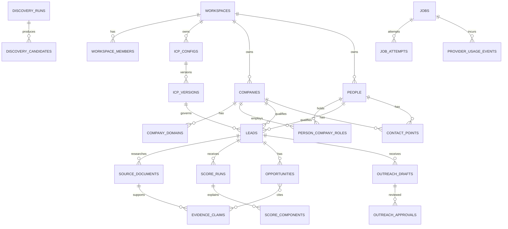

# Database design

**Status:** Long-term logical design. The M2A subset is implemented in the initial Alembic migration.  
**Target:** PostgreSQL 15+ / Supabase PostgreSQL

The implemented subset contains the M2A qualification records plus M3 provider configuration, jobs/attempts, discovery runs/candidates, budget policies/reservations, and provider usage events. It lives in the non-exposed `scout` schema with RLS enabled and no browser/Data API grants. Authentication, membership policies, people, contacts, outreach, and other later entities remain planned.

## 1. Design principles

- Use UUID primary keys and UTC `timestamptz` values.
- Scope tenant-owned data by `workspace_id`; avoid relying on indirect joins for RLS where a direct key is practical.
- Retain immutable source, claim, score, usage, attempt, approval, and audit history.
- Keep canonical columns typed. Use JSONB for versioned rule definitions, provider-specific metadata, and safe snapshots—not as a substitute for relational design.
- Store original and normalized identity values. Normalize in application code with database constraints as a backstop.
- Use soft lifecycle states for business records. Hard deletion follows an explicit retention workflow.
- Never store plaintext provider secrets in ordinary tables.

## 2. Relationship overview

## 3. Ownership and access

### `workspaces`

Tenant boundary: `id`, `name`, `slug`, `status`, `created_at`, `updated_at`. `slug` is globally unique.

### `user_profiles`

Application profile keyed by Supabase `auth.users.id`: `user_id`, display fields, `created_at`. Do not duplicate authentication credentials.

### `workspace_members`

`workspace_id`, `user_id`, `role` (`owner`, `admin`, `operator`, `reviewer`, `viewer`), status, timestamps. Unique `(workspace_id, user_id)`.

Authorization policies should query membership through a stable helper in a non-exposed schema or inline indexed membership checks. Do not use user-editable JWT metadata for roles.

## 4. ICP and qualification model

### `icp_configs`

Stable identity and display metadata: `workspace_id`, `name`, `pipeline_kind`, `status`, owner, timestamps. Unique active name per workspace/pipeline.

### `icp_versions`

Immutable published definitions: `icp_config_id`, integer `version`, `status`, `definition_json`, `definition_schema_version`, `published_at`, `created_by`. Unique `(icp_config_id, version)`. A check prevents modification once published.

The JSON definition contains validated industries, geographies, size bands, personas, exclusions, weighted rules, missing-value behavior, and thresholds. If individual fields become major query dimensions, promote them to relational child tables later.

### `leads`

One entity evaluated under an ICP version: `workspace_id`, `pipeline_kind`, `company_id`, `person_id`, `icp_version_id`, `stage`, `disposition`, `owner_user_id`, `first_seen_at`, `last_activity_at`, timestamps.

Constraints:

- `pipeline_kind = 'business'` requires `company_id` and forbids `person_id` as the subject.
- `pipeline_kind = 'individual'` requires `person_id`; an optional relationship to a company belongs in `person_company_roles`, not the lead subject.
- Unique active `(workspace_id, icp_version_id, company_id)` for business leads and corresponding person key for individual leads, implemented with partial unique indexes.

### `score_runs` and `score_components`

`score_runs` is immutable and includes `lead_id`, `icp_version_id`, algorithm version, total score, maximum score, normalized score, disposition, input evidence cutoff, missing-data summary, and time. `score_components` contains rule key, contribution, maximum contribution, result, explanation, and cited evidence IDs through `score_component_evidence`.

## 5. Identity model

### `companies`

`workspace_id`, canonical/display/legal names, normalized name, description, industry taxonomy, employee range, locality/region/country, status, first/last seen, timestamps. Do not make normalized name alone unique.

### `company_domains`

`company_id`, original domain, normalized registrable domain, domain type (`primary`, `alias`, `redirect`, `email`), verification state, source, timestamps. Unique `(workspace_id, normalized_domain)` when verification and policy make ownership unambiguous; suspected collisions require review.

### `people`

`workspace_id`, display/given/family names, normalized name, locality/region/country, public professional profile URL, status, first/last seen. Names are never unique identifiers.

### `person_company_roles`

Many-to-many employment/decision-maker history: `person_id`, `company_id`, title original/normalized, seniority, department, relationship type, current flag, start/end dates, evidence state, timestamps. A person can have multiple concurrent roles.

### `external_identifiers`

Provider/source identity keys: `workspace_id`, entity kind, company/person foreign key, provider, namespace, external ID, first/last seen. Check exactly one entity FK. Unique `(workspace_id, provider, namespace, external_id)`.

### `entity_match_keys`

Hashed/canonical exact match material such as domain, verified professional email, or canonical profile URL: entity kind/FK, key type, key hash, confidence, provenance, active flag. Uniqueness is conditional by key type; shared phone/address values must not force merges.

### `entity_match_candidates` and `entity_merge_events`

Possible duplicate pairs store algorithm version, features, score, status, and reviewer. Merge events store survivor, merged entity, actor, reason, reversible snapshot reference, and timestamp. A merge updates references transactionally; source/evidence history remains intact.

## 6. Discovery and source provenance

### `discovery_runs`

`workspace_id`, pipeline kind, ICP version, source/provider, query definition, status, requested/started/completed timestamps, cursor metadata, candidate counts, budget snapshot, creator.

### `discovery_candidates`

Append-oriented thin records: `discovery_run_id`, source record ID, raw-reference metadata, original/normalized name/domain/profile/location fields, fingerprint, status (`new`, `duplicate`, `possible_match`, `rejected`, `promoted`), resolved entity ID, reason, timestamps.

Unique `(discovery_run_id, source_record_id)` where supplied and `(discovery_run_id, fingerprint)` as a fallback. Cross-run identity resolution happens through match keys, not by discarding candidate history.

### `source_documents`

Metadata for a fetched page, API record, uploaded document, or import row: `workspace_id`, `lead_id` optional, source name/type, canonical URL, provider record ID, content hash, retrieved/observed times, HTTP/status metadata, content storage reference, license/cache policy, expiry, and redaction state.

Large/raw content should live in controlled object storage only if provider terms allow it. The database stores a reference and safe extracted text/metadata as needed.

### `evidence_claims`

Atomic assertions extracted from a source document: `workspace_id`, `source_document_id`, `claim_type`, typed `value_json`, normalized value, classification (`observed`, `provider_asserted`, `inferred`, `human_verified`), confidence, verification status, observed/retrieved/valid-until times, extractor/model version, review state, and supersession link.

Subject joins avoid unsafe polymorphic foreign keys:

- `company_evidence(company_id, evidence_claim_id)`
- `person_evidence(person_id, evidence_claim_id)`
- `lead_evidence(lead_id, evidence_claim_id)`

Claims are not overwritten. Corrections create a new claim and set `supersedes_claim_id`.

## 7. Opportunities and contacts

### `opportunities`

`workspace_id`, `lead_id`, service category, title, hypothesis text, rationale, confidence, status (`hypothesis`, `needs_review`, `accepted`, `rejected`, `stale`), author type/user/model, model and prompt versions, timestamps. Accepted status requires human actor and review time.

`opportunity_evidence` links supporting or contradicting claims with a relation enum.

### `contact_points`

`workspace_id`, exactly one of `company_id`/`person_id`, type (`email`, `phone`, `contact_form`, `social`, `other`), original value, normalized value, business-purpose label, source claim, verification status/method/provider, confidence, last verified, expiry, status, timestamps.

Use a partial unique index for active normalized values within a workspace and owner. Encrypt sensitive values at the application/column layer if the threat model requires it; hashes support equality/suppression checks without broad plaintext access. A predicted email pattern must use status `unverified_prediction` and cannot become a verified contact without verification evidence.

### `suppressions`

`workspace_id`, scope/type, normalized-value hash or entity FK, reason category, source, effective/expiry times, actor, and timestamps. Exact reason notes should be access-restricted. Active suppression lookup indexes must be fast and run before drafting/export/handoff where applicable.

## 8. Enrichment, jobs, and provider usage

### `enrichment_plans` and `enrichment_steps`

Versioned waterfall configuration per pipeline/ICP: provider operation, order, eligibility expression, requested fields, freshness target, estimated units, stop condition, fallback, enabled state.

### `jobs`

`workspace_id`, type, subject references, status, priority, payload reference, idempotency key, input fingerprint, scheduled time, lease owner/expiry, attempt count/max, parent job, created/updated/completed times. Unique `(workspace_id, job_type, idempotency_key)`.

### `job_attempts`

Immutable attempt number, worker ID, started/ended times, outcome, normalized error class/code, retry decision, next retry, safe diagnostic metadata. Raw secrets and personal payloads are forbidden.

### `provider_usage_events`

Append-only ledger: `workspace_id`, job/attempt, provider, operation, request correlation, status, estimated/actual units, unit type, estimated/actual cost and currency, cache hit, billable/settled flags, occurred time. Unique provider request ID where available.

### `budget_policies` and `budget_reservations`

Policies specify hard/soft caps by provider, operation, time window, run, and workspace. Reservations record estimated amount, expiry, settlement/release state, and linked usage. Reservation and cap check occur in one transaction.

## 9. Outreach, export, and audit

### `outreach_drafts`

`workspace_id`, `lead_id`, channel, recipient contact, subject/body, evidence IDs, generator/model/prompt versions, content hash, status, creator, timestamps. Editing changes the content hash and invalidates prior approval.

### `outreach_approvals`

Append-only decision: draft, exact content hash, approver, decision, note, suppression-check result/time, decided time, expiry. Only the latest valid approval for the current hash can authorize handoff.

### `outreach_handoffs`

Records an approved request to create an external draft or send if separately authorized: destination provider ID, idempotency key, status, response reference, timestamps. Initial scope permits Gmail draft creation only.

### `export_jobs`

Filter snapshot, selected fields, row count, status, storage reference, requester, expiry, and timestamps. Neutralize cells beginning with spreadsheet formula control characters for CSV/Sheets output.

### `audit_events`

Append-only actor, workspace, action, target type/ID, request/job correlation, safe metadata, IP/user-agent where appropriate, and timestamp. Partition later only if volume warrants it.

## 10. Index strategy

- B-tree indexes on every foreign key and common `(workspace_id, status)` filter.
- Partial indexes for active leads, roles, contact points, suppressions, queued jobs, and unsettled reservations.
- Unique normalized domain, external ID, idempotency, and published ICP version constraints described above.
- GIN only for demonstrated JSONB containment queries; do not index entire provider payloads by default.
- Trigram indexes on normalized names for candidate review, never as the sole automatic merge rule.
- Cursor indexes matching list sort order, such as `(workspace_id, score desc, id desc)`.
- Time indexes on evidence expiry, scheduled jobs, usage events, and audit timestamps.

Query plans should be captured for major list, matching, budget, and worker-claim queries before production volume.

## 11. RLS and database security

1. Enable RLS on every table in an exposed schema.
2. Default to no policies for `anon`. Grant `authenticated` only required table privileges; Data API grants and RLS are separate controls.
3. `SELECT` policies require active workspace membership. Mutations additionally check role and row workspace.
4. `UPDATE` policies define both `USING` and `WITH CHECK`; a matching `SELECT` policy is required.
5. Prefer API-only mutations for complex invariants. Do not expose raw provider, secret, usage-settlement, or audit internals to browser roles.
6. Views exposed to authenticated users use `security_invoker = true` where supported.
7. Avoid `SECURITY DEFINER`. If unavoidable, place functions in a private schema, revoke `PUBLIC` execute, set a safe search path, validate `auth.uid()`, and add dedicated tests.
8. Service-role credentials stay server-side and are never placed in `VITE_*` or other browser-exposed environment variables.
9. Add automated tests proving cross-workspace reads/writes fail for every exposed resource and role.

## 12. Retention and deletion

Approved defaults are documented in [compliance and retention](COMPLIANCE_AND_RETENTION.md): permitted raw website content up to 14 days, unqualified personal leads 90 days, qualified personal leads 180 days before review, active opportunities at least annual review, personal-data logs 30 days where feasible, and minimal suppression records as long as justified. Provider-specific stricter limits override defaults.

## 13. Migration strategy

- Establish extensions and schemas explicitly; pin expected PostgreSQL/Supabase behavior.
- Generate migrations with the installed Supabase CLI rather than inventing filenames.
- Review each migration for lock duration, table rewrites, reversibility, RLS, grants, and backfill safety.
- Test from an empty database and from a realistic prior snapshot.
- Run database/security advisors and RLS tests before approval.
- Never apply a migration to a shared or production project without explicit approval and a recovery plan.

## 14. Open database decisions

- Plain local PostgreSQL versus the full local Supabase stack for M2A.
- Whether provider raw content may be retained and where encryption keys are managed.
- Initial Supabase schemas exposed to the Data API.
- Required recovery point/time objectives and backup tier.
- Whether multi-tenant SaaS is near enough to require workspace quotas and billing fields immediately.
- Jurisdiction-specific deletion versus suppression retention rules.
